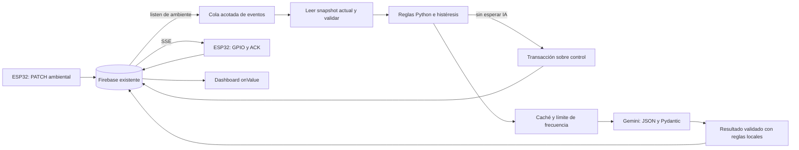

# Paso 8 · Supervisor AIoT de la Cava Inteligente

Supervisor Python/FastAPI para las rutas existentes de Firebase. Recibe cambios
ambientales con el Admin SDK, aplica reglas deterministas y solicita al ESP32
encender o apagar mediante `control`. Gemini aporta un análisis enológico
estructurado; no maneja el actuador ni sustituye las reglas locales.

**Estado de verificación:** pruebas locales con dobles y una generación real de
texto Gemini correcta. La prueba JSON original identificó un HTTP 400 de schema;
se corrigió la serialización, comprobada con el SDK y transporte HTTP simulado.
Falta repetir la generación JSON real tras la corrección. Firebase y el lazo
físico siguen pendientes. El arranque predeterminado es **DRY_RUN=true**, sin
ninguna escritura.

## 1. Preparar Ubuntu

Se verificó con Python **3.12.3** instalado. Desde la raíz del repositorio:

```bash
cd 03_supervisor_aiot
python3 -m venv .venv
source .venv/bin/activate
python -m pip install -r requirements.txt
```

Si Ubuntu no incluye soporte para `venv`, instalar el paquete `python3-venv`
apropiado para su Python desde los repositorios del sistema y repetir.
Si el entorno `.venv` ya existe, basta con activarlo e instalar los requisitos.

Versiones directas instaladas/verificadas y fijadas en `requirements.txt`:

| Paquete | Versión |
| --- | --- |
| FastAPI / Uvicorn | 0.162.0 / 0.54.0 |
| Firebase Admin SDK | 7.7.0 |
| google-genai | 2.33.0 |
| Pydantic / python-dotenv | 2.14.1 / 1.2.4 |
| pytest / pytest-asyncio | 9.1.1 / 1.4.0 |
| httpx, para validación ASGI y manejo de errores | 0.28.1 |

No se usa `google-generativeai`. Las dependencias se instalan solo en el entorno
virtual del supervisor, sin modificar el Python del sistema.

## 2. Configurar secretos locales

Si todavía no existe `.env`:

```bash
cp -n .env.example .env
mkdir -p credentials
```

Editar `.env` localmente, sin subirlo a Git. Se carga desde `03_supervisor_aiot/`,
independientemente del directorio desde el que se inicie Python. Las variables
ya exportadas en el proceso tienen prioridad sobre el archivo.

### Credenciales Firebase

En Firebase Console, seleccionar **unidad4-aiot-cava → Configuración del proyecto
→ Cuentas de servicio → Firebase Admin SDK** y generar/descargar una clave privada
del servidor si se dispone de autorización para el proyecto. Guardarla como:

```text
03_supervisor_aiot/credentials/firebase-service-account.json
```

Configurar `FIREBASE_CREDENTIALS_PATH` con esa ruta relativa a la carpeta del
supervisor o con una ruta absoluta. El certificado debe pertenecer al proyecto
`unidad4-aiot-cava`. La configuración pública del dashboard no reemplaza esta
credencial privada. No pegar el JSON en el frontend, el código o el chat.

Limitar sus permisos locales, por ejemplo:

```bash
chmod 600 .env credentials/firebase-service-account.json
```

El Admin SDK tiene acceso privilegiado según IAM; la protección de su clave es
independiente de las reglas del cliente web. No se cambian reglas automáticamente.
Consultar la [configuración oficial del Admin SDK](https://firebase.google.com/docs/admin/setup).

### API key y modelo Gemini

Crear o seleccionar una clave en [Google AI Studio](https://aistudio.google.com/api-keys),
con acceso a la Gemini API y al proyecto/cuota apropiados. Guardarla únicamente
en `GEMINI_API_KEY`. Ver la [guía oficial de claves](https://ai.google.dev/gemini-api/docs/api-key)
para los tipos de clave, permisos y restricciones vigentes.

Dejar inicialmente `GEMINI_MODEL=auto`. Con la key configurada:

```bash
python -m supervisor.check_config --list-models
python -m supervisor.check_config --probe-gemini
```

El primer comando consulta **los modelos disponibles para esa key** mediante
`client.aio.models.list()`. La selección automática prioriza Flash-Lite estable
con `generateContent`, luego otro Flash estable; excluye variantes de imagen,
voz/live y preview en la selección automática. No se fija un nombre que pueda
estar retirado o no disponible para la cuenta.

El listado por sí solo no acredita soporte JSON/Pydantic: `--probe-gemini` hace
**una solicitud estructurada real**, aislada, con 16 °C/70 %, y valida el
resultado. Puede consumir cuota; el SDK tiene `attempts=1`, sin reintentos
automáticos de generación. No requiere configurar Firebase Admin, no inicializa
Firebase y nunca escribe ni envía una orden. Conservar `GEMINI_MODEL=auto`.

Si funciona, muestra el modelo utilizado, generación y validación exitosas,
los tres campos verificados y el JSON validado. Si falla, informa tipo de
excepción, HTTP cuando existe, motivo controlado, causa y configuración a
revisar. Distingue autenticación (incluidas claves rechazadas con HTTP 400),
permisos, cuota 429, modelo ausente, schema no admitido, parámetros inválidos,
timeout, conectividad, JSON/Pydantic inválido y error local Python/SDK.
No imprime mensajes crudos del proveedor, URLs privadas ni entradas inválidas
de Pydantic. Un fallo de cierre también se informa sin exponer su mensaje.

Diagnóstico realizado el 24/10/2026, con `google-genai==2.33.0`:

- Una generación mínima real con `gemini-3.5-flash-lite` respondió `OK`.
- Una generación estructurada con el código anterior devolvió `ClientError`,
  HTTP 400: el endpoint rechazó `additional_properties` dentro de
  `response_schema`. El error se ocultaba como `autenticacion_o_modelo`.
- La causa era la serialización del schema, no el descubrimiento de modelos.
  `extra="forbid"` genera `additionalProperties: false`; `response_schema`
  lo convertía en el campo rechazado. Ahora se envía
  `response_json_schema=GeminiAssessment.model_json_schema()` y se conserva
  la validación local estricta con `model_validate_json`.
- El SDK y un transporte HTTP simulado verifican el cuerpo corregido y el
  resultado Pydantic. **La generación JSON real corregida está pendiente**:
  se respetó el límite de una prueba de texto y una estructurada, sin
  solicitudes adicionales ni cambio de modelo.

El `AssertionError` de una prueba distinta por entrada estándar se reprodujo
con `load_dotenv()` sin ruta: su búsqueda automática recorre frames que pueden
no corresponder a archivos existentes. `Settings.from_env()` ya usaba una ruta
absoluta; ahora el argumento se escribe explícitamente como
`load_dotenv(dotenv_path=BASE_DIR / ".env", override=False)`. Se prueba desde otro
directorio, sin búsqueda de frames y respetando variables exportadas. No usar
`load_dotenv()` sin ruta en pruebas por stdin.

Si el modelo configurado no está en el listado o falla la salida estructurada,
la IA queda no disponible y las reglas locales siguen operativas. Revisar
[models.list](https://ai.google.dev/api/models), el [SDK google-genai](https://googleapis.github.io/python-genai/)
y [salidas estructuradas](https://ai.google.dev/gemini-api/docs/structured-output).
Los nombres y claves usados en pytest son dobles explícitos; los tests no
consumen API. La comprobación JSON real pendiente se ejecuta con
`python -m supervisor.check_config --probe-gemini` desde esta carpeta, con `.venv`
activado. No añadir `--check-firebase` para verificar solo Gemini.

### Token del endpoint local

Generar un token local largo:

```bash
python -c 'import secrets; print(secrets.token_urlsafe(32))'
```

Copiar el resultado a `LOCAL_API_TOKEN` en `.env`. No incluirlo en URLs ni en
comandos con el token literal. `POST /evaluar` requiere este token en la cabecera
`X-Local-Token` y una conexión desde loopback. Sin un token de al menos 24 caracteres,
ese endpoint queda deshabilitado, incluso en DRY_RUN.

### Variables disponibles

| Variable | Predeterminado / función |
| --- | --- |
| `DRY_RUN` | `true`: ninguna escritura Firebase. |
| `FIREBASE_DATABASE_URL` | URL existente del proyecto; se rechaza otra base. |
| `FIREBASE_CREDENTIALS_PATH` | Completar con el JSON privado. |
| `FIREBASE_TIMEOUT_SECONDS` | `10`, para operaciones ordinarias Admin SDK. |
| `GEMINI_API_KEY` | Completar; si falta, IA no disponible y reglas activas. |
| `GEMINI_MODEL` | `auto` o un modelo de la key comprobado con la prueba estructurada. |
| `GEMINI_TIMEOUT_SECONDS` | `20`, límite del intento de análisis, incluido seleccionar modelo. |
| `GEMINI_MIN_INTERVAL_SECONDS` | `60`, mínimo global entre intentos; mínimo permitido 10. |
| `GEMINI_CACHE_SECONDS` | `300`, vigencia de resultados por perfil ambiental. |
| `GEMINI_RETRY_SECONDS` / `GEMINI_RETRY_MAX_SECONDS` | `120` / `900`, backoff exponencial de errores. |
| `RECOVERY_STABLE_SECONDS` | `60`, recuperación continua en rango ideal. |
| `MAX_MEASUREMENT_AGE_SECONDS` | `20`, antigüedad máxima admitida. |
| `MAX_SAMPLE_GAP_SECONDS` | `15`, mayor intervalo entre muestras para contar estabilidad. No supera la antigüedad máxima. |
| `FUTURE_TOLERANCE_SECONDS` | `5`, tolerancia al desajuste de reloj. |
| `SUPERVISOR_PUBLISH_SECONDS` | `60`, publicar de nuevo un resultado idéntico como máximo una vez por este intervalo. |
| `LISTENER_RETRY_SECONDS` | `5`, primer reintento de apertura; aumenta hasta 60 s. |
| `LOCAL_API_TOKEN` | Completar con un secreto local de al menos 24 caracteres. |
| `SUPERVISOR_LOCK_FILE` | `.runtime/supervisor.lock`, misma ruta para todos los procesos de este supervisor. |

Mantener NTP activo en Ubuntu y en el ESP32: la antigüedad se compara con UTC.

## 3. Comprobar configuración sin escribir

Con el entorno activado y dentro de `03_supervisor_aiot/`:

```bash
python -m supervisor.check_config
python -m supervisor.check_config --check-firebase
```

El primero informa versiones y presencia de configuración, sin imprimir secretos.
El segundo hace una lectura administrativa, verifica tipos/antigüedad ambiental
y el estado de control. Si la placa está apagada o no envía datos válidos,
la comprobación puede fallar por antigüedad aunque las credenciales sean correctas.
Los comandos de comprobación nunca publican en Firebase, incluso con DRY_RUN=false.

## 4. Iniciar FastAPI en DRY_RUN

Confirmar `DRY_RUN=true` y ejecutar:

```bash
uvicorn main:app --host 127.0.0.1 --port 8001 --workers 1 --no-proxy-headers
```

No usar varios workers ni otro supervisor simultáneo. El lock de archivo rechaza
un segundo proceso que use la misma ruta; no borra un lock activo ni abre otro
listener. Evitar `--reload` durante las pruebas del lazo físico.

En otra terminal:

```bash
curl http://127.0.0.1:8001/health
curl http://127.0.0.1:8001/status
```

Documentación interactiva: **http://127.0.0.1:8001/docs**. En Authorize se puede
ingresar el token local para probar `/evaluar`, sin publicarlo ni guardarlo en Git.

- `GET /health`: servidor activo, DRY_RUN, configuración Firebase/Gemini, listener
  y frescura de la última muestra. No hace un ping externo por cada petición.
  `operativo_reglas_locales` distingue protección local de un análisis IA disponible.
- `GET /status`: última evaluación, origen/estado solicitado observado, acción
  propuesta/enviada, análisis IA, última comunicación válida, muestra y evento.
- `POST /evaluar`: lee los datos actuales de Firebase, sin admitir mediciones
  simuladas en el cuerpo ni forzar saltos de caché/frecuencia Gemini.

Para llamar al POST sin poner secretos literales en la línea de comandos:

```bash
python - <<'PY'
from dotenv import dotenv_values
import httpx
token = dotenv_values('.env').get('LOCAL_API_TOKEN', '')
response = httpx.post('http://127.0.0.1:8001/evaluar', json={},
    headers={'X-Local-Token': token}, timeout=30)
print(response.status_code)
print(response.text)
PY
```

El POST devuelve 403 ante origen remoto/token inválido, 503 si no está habilitado
o falla Firebase y 409 ante datos inválidos/antiguos. Campos inesperados en el
cuerpo producen 422. No hay CORS abierto y se validan hosts locales. El modo
real no se puede activar desde un endpoint.

Sin credenciales, el arranque predeterminado permite inspeccionar `/health`
y `/status` en estado degradado, sin listeners ni llamadas a Gemini.

## 5. Arquitectura y ciclo de vida



`lifespan` crea una sola instancia del coordinador. El listener usa
`Reference.listen()` exclusivamente en `ambiente`. Cada evento/reconexión señala
una cola de tamaño 1; el consumidor lee un snapshot actual de la zona para
evaluar ambiente y control coherentes. No reconstruye una cola de órdenes viejas
ni usa polling ambiental. Los GET se disparan por eventos o por el POST explícito.

Firebase Admin es síncrono: apertura, lecturas, transacciones, publicaciones y
cierre se ejecutan con `asyncio.to_thread()`. La generación Gemini usa el cliente
asíncrono. Un análisis lento no mantiene el lock de evaluación ni retrasa el
primer encendido por reglas. Si llegan nuevos eventos mientras trabaja Gemini,
las reglas siguen evaluándose y los eventos se condensan.

Al terminar se cancelan y esperan las tareas, se cierra el registro SSE, se
recoge incluso un listener que todavía terminaba de abrir en un hilo, se cierran
los clientes Gemini/Firebase y se libera el lock. El SDK administra las
reconexiones normales; si muere su hilo, se cierra el registro antes de reabrirlo.
La observación del hilo experimental queda aislada en el adaptador fijado a 7.7.0.

**Límites del listener:** Firebase documenta que `listen()` es experimental y
no respeta los timeouts ordinarios. El valor FIREBASE_TIMEOUT_SECONDS no limita
esa conexión persistente; la apertura/cierre pueden esperar al transporte ante
problemas de red. No se promete un cierre instantáneo bajo cualquier falla de
red. Ver [Reference.listen()](https://firebase.google.com/docs/reference/admin/python/firebase_admin.db).

El lock es exclusión de procesos locales con la misma ruta, no un lease
distribuido. No ejecutar supervisores en dos equipos/checkouts con locks distintos.
Una futura instalación distribuida necesita liderazgo externo; no se agregaron
nodos de coordinación a la estructura Firebase existente.

### Módulos

| Archivo | Función |
| --- | --- |
| `main.py` | FastAPI, lifespan, hosts y protección del POST. |
| `supervisor/config.py` | `.env`, secretos, URL y validación del modo real. |
| `supervisor/models.py` | Modelos Pydantic, tipos estrictos y timestamps. |
| `supervisor/rules.py` | Umbrales, propiedad manual/automática e histéresis. |
| `supervisor/firebase.py` | Admin SDK, listener, transacción de control y update del supervisor. |
| `supervisor/gemini.py` | google-genai, selección, schema, errores y cierre. |
| `supervisor/runtime.py` | Coordinador, cola, caché, frecuencia, publicación y estado. |
| `supervisor/singleton.py` | Lock local entre procesos. |
| `supervisor/check_config.py` | Diagnóstico, listado y prueba estructurada explícitos. |
| `tests/` | pytest con servicios simulados y sin credenciales reales. |

## 6. Reglas y escrituras

| Condición | Decisión |
| --- | --- |
| T > 22 °C o HR < 60 % | Solicitar encendido si todavía está solicitado apagado. |
| T = 22 °C y HR = 60 % | No son condiciones críticas por sí mismas. |
| T en 12–18 °C y HR en 65–80 % | Rango ideal, con extremos incluidos. |
| Encendido automático, ambiente fuera del ideal | Mantener mitigación, aunque ya no sea crítico. |
| Encendido automático, ideal continuo durante RECOVERY_STABLE_SECONDS | Solicitar apagado. |
| Encendido de origen manual, ambiente normalizado | Conservar encendido manual. |
| Datos inválidos, ausentes, futuros o antiguos | No emitir nuevas órdenes ni publicar una evaluación nueva; reiniciar recuperación. |

Se rechazan booleanos como números, strings en métricas, NaN, infinitos,
temperatura fuera de −40 a 80 °C y humedad fuera de 0–100 %. El firmware usa
timestamp de servidor Firebase en milisegundos, inspeccionado en el Paso 7
(`1792851315451`); el código del firmware sigue usando `.sv: timestamp` sin cambios.
También se admiten epoch en segundos e ISO con zona explícita.

La recuperación avanza por timestamps de muestras nuevas, no por repetir POST
ni por un evento de reconexión. Un intervalo mayor de MAX_SAMPLE_GAP_SECONDS,
datos inválidos o reiniciar el proceso reinicia el período de estabilidad.
Conservar `origen="supervisor"` permite reconocer una orden automática anterior
al reinicio; la espera estable empieza de nuevo. Un origen distinto de supervisor
no autoriza a apagar automáticamente un encendido ya solicitado.

**Prioridad crítica:** un APAGAR manual puede ser revertido en la siguiente
evaluación ambiental válida mientras T > 22 °C o HR < 60 %. Un encendido que ya
sea manual no se reapropia como automático innecesariamente.

Las órdenes actualizan booleano y origen juntos con una transacción sobre
`control`. El callback conserva todos sus otros hijos y verifica el snapshot
observado. Un cambio concurrente aborta esa escritura, sin reintentar a ciegas
sobre la intención manual nueva; el siguiente evento vuelve a evaluar. Las
transacciones no ejecutan código de IA ni efectos secundarios en su callback.

Los resultados usan `update()` en `supervisor` sobre los cuatro campos existentes:
`alerta_calidad`, `forzar_climatizacion`, `impacto_enologico`, `ultima_evaluacion`.
Los dos booleanos finales proceden de Python, aun si Gemini recomienda otra cosa.
La fecha es ISO 8601 UTC. Campos ajenos se conservan. No se escribe el nodo padre
de la zona ni se toca **extractor_confirmado**.

No se repite una orden que ya coincide con lo solicitado. Un resultado de
supervisor idéntico se publica solo al vencer SUPERVISOR_PUBLISH_SECONDS;
cambios de estado/análisis se publican antes. La coincidencia con solicitado
no acredita ACK ni ejecución eléctrica: eso lo sigue informando el ESP32.

## 7. Frecuencia, caché y errores de IA

El perfil de análisis combina estado ambiental, anomalías, bandas de 2 °C y de
5 % de humedad e histéresis. Hay un único análisis en vuelo y una caché acotada a
32 perfiles, con TTL configurable. Oscilaciones pequeñas y PATCH cada 5 s no
generan una llamada nueva a Gemini. Cambios relevantes respetan también el
mínimo global de frecuencia; un POST no lo evita.

Gemini devuelve solo los tres campos tipados mediante JSON/schema Pydantic.
No recibe herramientas ni acceso Firebase, no ejecuta código ni decide GPIO.
Una explicación válida se identifica como `[Gemini · modelo · muestra ...]`.
Si se reutiliza la caché, se indican los valores de la muestra analizada: el
timestamp de última evaluación publicado corresponde a la evaluación local.

Un resultado que llegue después de cambiar el perfil no se publica como si
describiera el perfil actual. Tampoco se publica si la muestra actual ya es
antigua. Los booleanos locales prevalecen sobre respuestas contradictorias.

Errores 429, timeout, conectividad, modelo/credenciales y JSON inválido producen
**Análisis IA no disponible**, con un motivo controlado y reintento con backoff.
No se muestra una explicación inventada como si fuera de Gemini. La protección
determinista sigue actuando; una caída de la IA no autoriza apagar el actuador.

## 8. Probar DRY_RUN y activar el modo real

Con `DRY_RUN=true`, el servicio puede leer Firebase, analizar mediante Gemini y
mostrar `dry_run_encender`/`dry_run_apagar` en `/status` y consola. **No escribe
ningún dato en Firebase**, ni control ni supervisor. El Dashboard continúa
mostrando sus registros previos: no es una falla de lectura del dashboard.
No existe un endpoint para cargar datos simulados a la producción.

1. Conservar DRY_RUN=true y ejecutar las comprobaciones Firebase/Gemini anteriores.
2. Iniciar el servicio y consultar `/status`. Confirmar datos recientes, origen
   correcto y resultados locales. Verificar en Firebase que no cambian los nodos
   por este proceso. Durante DRY_RUN, los controles manuales del dashboard siguen
   siendo los del Paso 7 y sí pueden enviar órdenes si el usuario los pulsa.
3. Probar los escenarios de la placa sin cambiar firmware: `1` normal,
   `2` temperatura alta (24 °C), `3` humedad baja (55 %), `9` lectura inválida
   que detiene los PATCH. Observar decisiones propuestas y antigüedad, sin
   atribuir el estado del LED a una orden del supervisor en modo seco.
4. Detener con Ctrl+C. Completar/verificar credenciales, token y permisos; cambiar
   **solo localmente** a `DRY_RUN=false` y volver a iniciar. El modo real rechaza
   configuración sin archivo privado o sin token local suficientemente largo;
   el certificado debe ser válido y del proyecto. Cada acción requiere primero
   leer y validar datos actuales de Firebase. Gemini puede quedar no disponible
   sin detener las reglas críticas locales.
5. En escenario `2`, comprobar solicitado `true`/origen `supervisor`, recepción
   SSE, LED GPIO 2 y después ACK `extractor_confirmado=true`. Repetir escenario `3`.
6. Volver a `1` y mantener muestras recientes durante el período estable (60 s
   por defecto, más la alineación del PATCH). Comprobar apagado solicitado y ACK.
7. Probar encendido manual del dashboard en condiciones ideales: debe conservarse
   al pasar el tiempo estable. Probar APAGAR manual en condición crítica sabiendo
   que la protección puede reponer ENCENDER al próximo evento ambiental válido.
8. En el Dashboard, ver los cuatro campos del supervisor actualizarse por sus
   `onValue()` existentes. La única modificación del frontend en este paso es el
   texto introductorio que ahora describe al supervisor externo; no cambia controles.

Estas pruebas con la base y el ESP32 todavía deben realizarse físicamente. No se
acredita control correcto del hardware solo por publicar solicitado o pasar pytest.

## 9. Si Firebase o la red dejan de responder

Una lectura fallida o una muestra inválida/antigua impide emitir una nueva orden;
se reinicia la espera de recuperación y `/status` informa el problema. Se mantiene
el último estado del actuador: no se inventa un ACK ni se ordena un apagado de
emergencia sin datos. El listener reintenta su conexión; al reconectar se vuelven
a leer los datos actuales, no se reproducen órdenes históricas en cola.

Si una escritura falla, no se afirma éxito físico y se vuelve a evaluar con los
siguientes datos válidos. El intervalo de publicación/caché se registra únicamente
después de una publicación aceptada. Los errores de proveedores se registran con
motivos controlados, sin imprimir API keys, tokens o JSON de credenciales.

Detener el proceso con **Ctrl+C**. Para salir del virtualenv, ejecutar `deactivate`.
Detener el supervisor no apaga por sí mismo el GPIO; la última orden permanece
en Firebase y el control manual existente sigue disponible.

## 10. Pruebas y límites de verificación

Desde `03_supervisor_aiot/`, con `.venv` activado:

```bash
python -m pytest -q
python -m pip check
```

Las pruebas no requieren credenciales ni hacen peticiones a Firebase/Gemini.
Cubren umbrales estrictos, normalización, intención manual, concurrencia,
mediciones inválidas/antiguas, independencia de Gemini, 429/timeouts/JSON inválido,
caché, reconexiones, escritura limitada a las rutas autorizadas, DRY_RUN, lock,
cierre, CLI sin secretos y validación de FastAPI mediante transporte ASGI.

Resultado tras el diagnóstico Gemini: **84 pruebas aprobadas**, sin fallos.
Incluyen el cuerpo HTTP real serializado por el SDK mediante un transporte
simulado, diagnóstico HTTP 400/401/403/404/429/503, ausencia de secretos,
validación estricta y carga explícita de `.env` desde otro directorio.

FastAPI se valida con `/health`, `/status`, `/docs`, `/openapi.json`, POST protegido,
cuerpo inválido, host/origen remoto, ausencia de CORS abierto y errores controlados.
El transporte ASGI prueba endpoints y lifespan, no implica una prueba en un puerto
TCP real ni del lazo físico. La suite y `pip check` deben terminar sin fallos.

La API key local permitió generar texto real; el JSON original falló por el
schema y el cambio requiere la comprobación real indicada en la sección Gemini.
Falta comprobar escucha SSE con credenciales, permisos administrativos,
transacciones reales, Dashboard y lazo completo con la placa. No se hicieron
lecturas ni escrituras Firebase durante el diagnóstico Gemini, ni se inició
FastAPI. El `.env` privado se conserva sin cambios.

`.gitignore` cubre `.env`, `.venv`, JSON/PEM/KEY del supervisor, `credentials/` y
`.runtime/`. `.env.example` queda versionable. No guardar secretos en otras rutas
no protegidas y no usar `git add -f` sobre credenciales. No se modificaron firmware,
secrets.h ni reglas de Firebase. No se hizo commit ni push.
