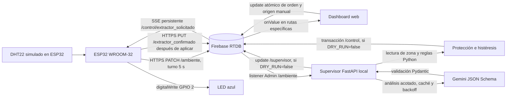

# Arquitectura implementada

Unidad 4 · Cava de crianza · Pasos 1 a 8 implementados, Paso 9 en validación.

Todas las rutas siguientes dependen de `/bodega/zona_crianza`:

| Ruta | Emisor | Consumidores | Contrato |
| --- | --- | --- | --- |
| `ambiente` | ESP32 | Dashboard y supervisor | `temperatura`, `humedad` numéricas; `timestamp` servidor en ms |
| `control` | Dashboard / supervisor | ESP32 y supervisor; Dashboard muestra el estado | `extractor_solicitado` booleano, `origen` manual/supervisor |
| `extractor_confirmado` | ESP32 | Dashboard; supervisor lo puede leer al leer la zona | Booleano del estado aplicado |
| `supervisor` | Supervisor | Dashboard | Dos booleanos, explicación y `ultima_evaluacion` ISO UTC |

El firmware mantiene una tarea y un cliente TLS exclusivos para SSE. Otra tarea
serializa PATCH y PUT, con prioridad para ACK y un cliente TLS nuevo por
petición; cierra HTTP/TLS antes de liberar los objetos. El bucle local atiende
serie, simulación, Wi-Fi, hora y GPIO. Un turno PATCH puede omitirse si no hay
red/hora válida, la lectura es inválida o hay una escritura en curso; no se
acumulan muestras antiguas. SSE se reconecta con espera creciente y valida TLS
en cada salto HTTPS permitido. No consulta periódicamente la orden.

Después de ejecutar `digitalWrite()` y actualizar el estado local se registra
el ACK. Si el pin ya tenía el valor solicitado, no se vuelve a conmutar y sí
se vuelve a confirmar. Sus versiones son internas: impiden que una respuesta
antigua resuelva una confirmación nueva; no viajan a Firebase. Solo HTTP 200
resuelve el ACK pendiente. Las caídas conservan el último estado aplicado.

El Dashboard usa eventos `onValue()` y temporizadores locales para avisos de
frescura y ACK; esos temporizadores no consultan Firebase. El control manual
actual requiere localhost y conexión. Ese filtro en JavaScript no reemplaza
autenticación ni reglas de servidor. `.info/connected` describe la conexión del
navegador, no la presencia del ESP32.

El supervisor se ejecuta con un proceso, un lock de instancia y evaluaciones
serializadas. El listener Admin avisa cambios de ambiente y se lee la zona
para validar medición y control. No se utiliza un polling de órdenes. Primero
se resuelven reglas y transacción; luego se inicia Gemini sin demorar la
protección. La transacción conserva hijos existentes y aborta si el control
cambió desde la lectura. Las muestras inválidas o antiguas no producen órdenes.
Las respuestas IA atrasadas no se publican como estado actual.

T>22 °C o HR<60 % requieren mitigación. Un encendido del supervisor solo se
apaga tras 60 s continuos de muestras nuevas ideales, con intervalos admitidos;
se respeta un encendido manual fuera de criticidad. Los booleanos publicados
proceden de Python aunque la IA recomiende algo distinto. `DRY_RUN=true` evita
las dos clases de escritura del supervisor, manteniendo evaluación/diagnóstico.

El lazo confirma ejecución lógica y visualización, no un efecto microclimático
físico: el DHT22 está simulado y GPIO 2 representa el actuador. La igualdad de
dos booleanos sin timestamp/ID de orden tampoco demuestra un ACK nuevo.

Las reglas desplegadas no están disponibles localmente. Los clientes actuales
no implementan Firebase Auth y Admin usa privilegios elevados. La migración
propuesta, sus límites y el emulador aislado se describen en
[paso9-seguridad.md](paso9-seguridad.md); no se cambió la autenticación existente.
